# TurtleBot3 visual waypoint navigation and ArUco docking (41014 Integrated Project, Track A)

A simulated TurtleBot3 Burger in MuJoCo works through the room in five steps:

1. **Localises** itself from ArUco markers on the walls.
2. **Maps** unknown obstacles with its 2D LiDAR.
3. **Plans** a path with A*.
4. **Tracks** the path with a gain-scheduled LQR controller.
5. **Docks** visually at the ArUco-marked charging station.

Every control command is computed from the EKF estimate, which fuses wheel
odometry with range and bearing to the markers. Ground truth is used only to
score the runs. The `SimRobot` / `GroundTruthProbe` split in
[`tb3dock/sim.py`](tb3dock/sim.py) makes this visible in the code, and
`grep GroundTruthProbe tb3dock/mission.py` returns nothing.

**Headline results.** Each trial uses a random obstacle layout and start pose,
and success means docking within 30 mm / 20 mm / 3°.

| Condition | Docking success |
|---|---|
| Nominal | 30/30 |
| Six disturbance conditions (pushes, 10 s camera blackout, 3× sensor noise, motor gain mismatch, low tyre friction, all combined) | 71/72 |
| Same pipeline without the camera after start-up | 0/12 |
| Same pipeline without calibration | 1/12 |

In the nominal trials the median final lateral docking error is 1.0 mm (95th
percentile 3.4 mm).

> Demo video: `<link to the 5-minute video>`  ·  Project page: this README

---

## Contents
1. [Quick start](#1-quick-start)
2. [System overview](#2-system-overview)
3. [Part A: modelling, controllability and observability](#3-part-a-modelling-controllability-and-observability)
4. [Part B: sensing, calibration and frames](#4-part-b-sensing-calibration-and-frames)
5. [Part C: estimation](#5-part-c-estimation)
6. [Part D: control](#6-part-d-control)
7. [Part E: integration and robustness](#7-part-e-integration-and-robustness)
8. [Failures, diagnosis and limits of the approach](#8-failures-diagnosis-and-limits-of-the-approach)
9. [Reproducing every result](#9-reproducing-every-result)
10. [Repository layout](#10-repository-layout)
11. [Contribution statement](#11-contribution-statement)
12. [Generative AI declaration](#12-generative-ai-declaration)

---

## 1. Quick start

```bash
git clone https://github.com/<your-group>/<repo-name>.git && cd <repo-name>
python -m venv .venv && source .venv/bin/activate
pip install -r requirements.txt
# headless Linux: sudo apt install libosmesa6 && export MUJOCO_GL=osmesa
# macOS / Windows with a display: export MUJOCO_GL=glfw

python scripts/run_mission.py --seed 101                    # one nominal mission (~25 s)
python scripts/run_mission.py --seed 101 --dist combined    # pushes + camera blackout + noise + slip
python scripts/run_mission.py --seed 101 --gyro             # gyro-aided EKF variant
```

Watch a mission live (needs a screen):

    python scripts/view_mission.py --seed 101                    # live dashboard (top view + robot camera + error plots)
    python scripts/view_mission.py --seed 104 --dist combined    # disturbed run
    python scripts/view_mission.py --seed 101 --mode 3d          # interactive MuJoCo 3-D viewer (macOS: use mjpython)


`config/calibration.json` is committed, so a mission runs straight away.
`./reproduce.sh` regenerates every calibration, table, figure and video from
scratch (about 2.5 h on 2 cores, dominated by the Monte Carlo runs).

Tested with Python 3.13, MuJoCo 3.15 and OpenCV 5.0 on Linux.

## 2. System overview

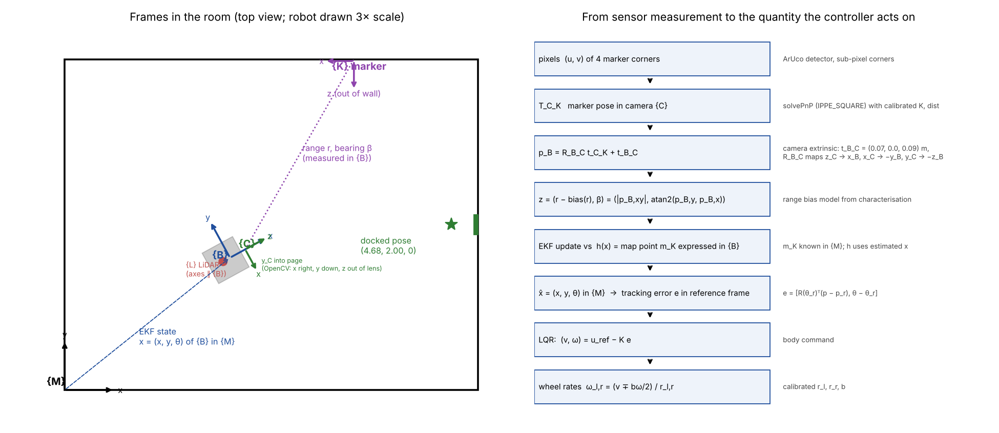

The pipeline runs as a state machine ([`tb3dock/mission.py`](tb3dock/mission.py)).
The control loop and EKF prediction run at 20 Hz, the camera at 10 Hz and the
LiDAR at 5 Hz.

| Phase | What happens | Ends when |
|---|---|---|
| `GYRO_BIAS` | Stands still for 1 s and averages the gyro | 1 s elapsed |
| `INIT` | Spins one revolution collecting marker observations, then solves the global pose by robust batch least squares ([`localisation.py`](tb3dock/localisation.py)) | Pose solved, EKF initialised |
| `PLAN` | A* on the LiDAR occupancy grid to the pre-dock pose (0.55 m in front of the dock) | Path found |
| `ALIGN` | Rotates in place onto the path heading | Heading error < 0.08 rad |
| `TRACK` | LQR tracking. A replan is triggered if a new scan blocks the path; emergency stop on returns < 0.24 m ahead | Pre-dock pose reached |
| `FACE_DOCK` | Rotates to face the dock marker | Heading error < 0.03 rad |
| `DOCK` | Straight-line LQR approach at 6 cm/s, with the dock marker dominating the EKF | Estimate within 1 cm of the docked pose |

**Re-localisation.** If the EKF rejects every in-envelope marker for 15
consecutive frames, the robot stops and returns to `INIT`. The chi-square
gate only protects the filter; this watchdog protects the gate (§8).

**The world** ([`tb3dock/scene.py`](tb3dock/scene.py)):

* **Room.** 5 m × 4 m with 3–5 random box or cylinder obstacles. The robot is
  not told where the obstacles are.
* **Markers.** Eight 160 mm ArUco landmarks on the walls, plus a 100 mm dock
  marker (id 0). Their map positions are the only prior world knowledge,
  together with the room footprint.
* **Hidden geometry.** The simulated robot uses wheel radii 33.6 / 32.7 mm and
  a 163.5 mm track. The software only knows the 33.0 mm / 160 mm datasheet
  values until calibration.

## 3. Part A: modelling, controllability and observability

Code: [`tb3dock/model.py`](tb3dock/model.py) · Analysis: [`scripts/analyse_model.py`](scripts/analyse_model.py) · Data: [`results/model_analysis.json`](results/model_analysis.json)

### 3.1 Model derived for this platform

**Assumptions.**
* Planar rigid body.
* Rolling without slip at the two drive wheels.
* Frictionless ball caster.
* Wheel actuators behave as first-order velocity loops.

The model's own failures are characterised in §7 (pushes, low friction).

**Wheel kinematics.** These use the *calibrated* radii and track (§4.2):

```
v = (r_r ω_r + r_l ω_l) / 2,     ω = (r_r ω_r − r_l ω_l) / b
r_l = 33.28 mm, r_r = 32.39 mm, b = 163.4 mm
```

**Pose kinematics** (unicycle), with state x = [x, y, θ] and input u = [v, ω]:

```
ẋ = v cos θ,   ẏ = v sin θ,   θ̇ = ω
```

**Actuator dynamics.** These were identified from encoder step responses
([`scripts/identify_actuator.py`](scripts/identify_actuator.py)). The fit is
τ ω̇ = K ω_cmd − ω, with τ = 24.6 ms (range 18–39 ms across amplitudes) and
K = 1.00. A second-order fit (ωn = 52 rad/s, ζ = 0.69) captures a 10–15 %
overshoot. That overshoot comes from chassis pitch coupling, which the
first-order model ignores.

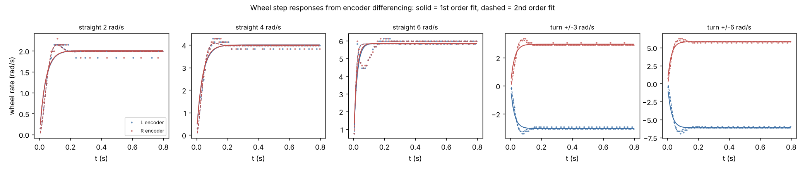

**Tracking-error model.** This is the design model for the LQR. It is
linearised about a reference (x_r, v_r, ω_r). The error is
e = [R(θ_r)ᵀ(p − p_r), θ − θ_r] and the input deviation is δu = u − u_r:

```
ė = A_e e + B_e δu,   A_e = [[0, ω_r, 0], [−ω_r, 0, v_r], [0, 0, 0]],   B_e = [[1, 0], [0, 0], [0, 1]]
```

It is discretised exactly (zero-order hold) at dt = 50 ms.

### 3.2 Controllability

| Linearisation | rank 𝒞 |
|---|---|
| Moving, v_r = 0.15 m/s | 3 (controllable) |
| Turning in place, ω_r = 0.8 rad/s | 3 |
| At rest, v_r = ω_r = 0 | **2**: lateral error cannot be corrected by linear feedback (Brockett's condition) |
| Actuator-augmented 5-state model | 5 |

This result drives two design choices:

* The LQR gain floors |v_r| at 5 cm/s.
* Pure rotations (`ALIGN`, `FACE_DOCK`) use a separate heading controller.

The left panel of the figure below maps the smallest singular value of the
controllability matrix over the operating envelope.

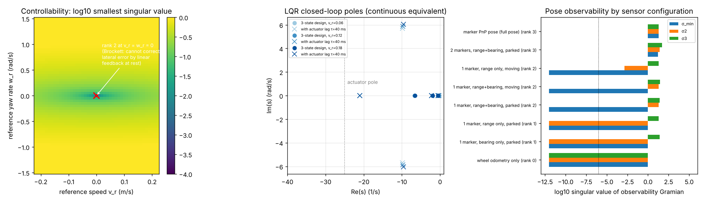

### 3.3 Observability: which states each sensor makes observable

This uses the empirical local observability Gramian of the *nonlinear* model
(right panel above).

| Sensor configuration | Observable pose directions | Unobservable direction |
|---|---|---|
| Wheel odometry only | 0 (absolute pose) | All. Odometry only integrates; drift is unbounded |
| 1 marker, bearing only | 1 | 2-D family |
| 1 marker, range only | 1 | Heading, and position along the range circle |
| **1 marker, range + bearing (parked *or moving*)** | **2** | **Rigid rotation of the robot about the marker**, [0.49, −0.73, 0.49], which equals the analytic null space of H |
| 2 markers, range + bearing | 3 | None |
| Single-marker PnP pose | 3 | None (uses marker orientation, but heading is weak for small markers) |

The 1-marker case stays rank 2 even while moving. Rotating the robot's whole
trajectory about a point landmark leaves every range and bearing unchanged.
Two consequences follow:

* **Localisation needs two or more markers.** The start-up spin collects
  enough markers before solving.
* **Heading becomes unobservable when markers leave the view.** If only the
  dock marker is visible, heading is unobservable from it alone, apart from
  what odometry carries forward. When no marker is visible, the EKF covariance
  grows at the rate set by Q. This is visible in the camera-blackout trials
  (§7).

### 3.4 Actuator lag versus control bandwidth

The fastest designed closed-loop pole is −6.6 s⁻¹, more than 6× slower than
the actuator (1/τ = 41 s⁻¹, or 25 s⁻¹ for the slowest identified τ). The
closed loop was also evaluated on the 5-state plant with the same gain and
τ = 40 ms. Its spectral radius is unchanged (0.973 at v_r = 0.18 m/s), so
designing on the 3-state kinematic model is justified.

## 4. Part B: sensing, calibration and frames

### 4.1 Camera intrinsics

Script: [`scripts/calibrate_camera.py`](scripts/calibrate_camera.py)

A 9×6 checkerboard with 30 mm squares was shown in 40 random poses, at
0.35–0.9 m and ±35° tilt. The fit has a reprojection RMS of 0.42 px.

| Parameter | Result vs simulator truth | Reported 1σ |
|---|---|---|
| Focal length f | +0.48 % | 0.2 % |
| Principal point c_x | −0.42 px | 0.41 px |
| Principal point c_y | −0.40 px | 0.56 px |

The focal error is about 2.4× its reported 1σ. OpenCV's standard errors
understate the true calibration error, and the residual is absorbed by the
range-bias model in §4.3. Tangential distortion and k3 were fixed at zero;
with 40 views they traded off against c_x and biased it by 3.4 px.

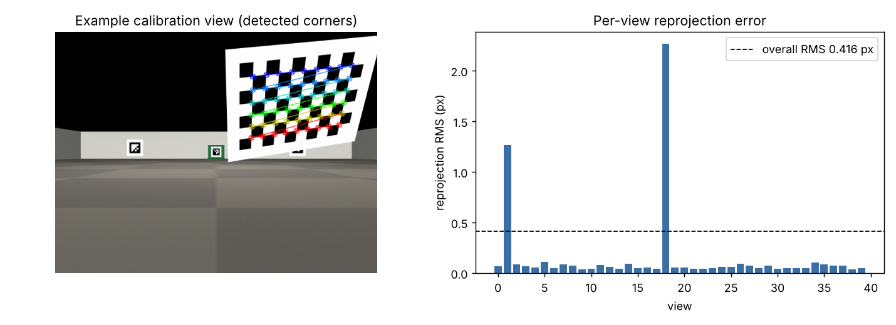

### 4.2 Odometry calibration (systematic errors)

Script: [`scripts/calibrate_odometry.py`](scripts/calibrate_odometry.py)

The robot drove UMBmark 1.5 m squares clockwise and counter-clockwise, plus
straight runs. Results were validated on 6 held-out random 20 s trajectories.

| Parameters | r_l (mm) | r_r (mm) | b (mm) | Held-out end-position error | End-heading error |
|---|---|---|---|---|---|
| Datasheet (nominal) | 33.00 | 33.00 | 160.0 | 473 mm | 28.8° |
| UMBmark closed form | 33.25 | 32.75 | 151.4 | 334 mm | 17.7° |
| **Least squares, all runs (used)** | **33.28 ± 0.06** | **32.39 ± 0.06** | **163.4 ± 0.3** | **72 mm** | **2.3°** |
| Simulator truth (hidden) | 33.60 | 32.70 | 163.5 | | |

* **Least squares.** Our fit re-integrates the logged ticks and minimises
  end-pose error over every run. It recovers the radius *ratio* and the track
  almost exactly.
* **Effective rolling radius.** Both radii come out about 1 % below truth.
  That is the effective rolling radius of a tyre compressed into the soft
  contact, which is what odometry needs.
* **Why UMBmark does worse here.** UMBmark assumes the squares close. They do
  not when open-loop in-place turns use nominal parameters, and UMBmark cannot
  observe absolute scale.

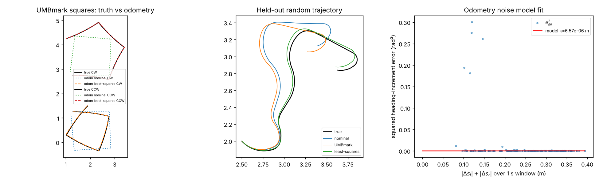

### 4.3 Marker measurement model (noise handling)

Script: [`scripts/characterise_markers.py`](scripts/characterise_markers.py)

The robot was placed on a test rig at 758 surveyed poses. These covered ranges
0.25–3.5 m, view angles 0–70° and five markers including the dock. Each image
went through the mission's own detector, and the result was compared with the
range and bearing implied by the surveyed pose.

**Range bias.** PnP over-estimates range by an amount that grows roughly with
r². This is the signature of an approximately constant 0.3 px inward shift of
the detected corners. It is modelled with range normalised to marker size
(rn = r·0.16/s):

  bias = (−1.8 rn + 7.0 rn²) mm × s/0.16

The model reduces the mean bias from 26 mm to 4 mm.

**Noise (R).**

* σ_r = (3.0 + 2.9 rn²) mm × s/0.16
* σ_β = 0.12°

Both are fitted from the data and inflated by 1.5× to cover tails. That
inflation is checked against NIS and NEES in §5.

**Envelope.** Measurements with rn > 2.5 m or a view angle > 60° are
*rejected rather than modelled*, because beyond that the errors become
heavy-tailed (grazing views, ambiguous PnP). The detection rate is above 94 %
from 0.8 to 3 m and drops below 0.6 m, where the marker overfills the frame.

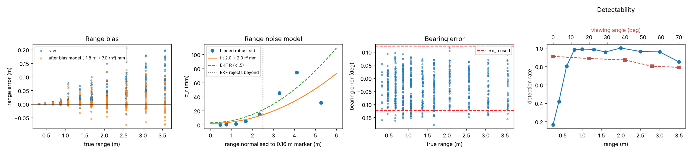

### 4.4 Odometry noise (Q)

The noise model is σ² = k·|Δs| per wheel, with k = 6.6 × 10⁻⁶ m.

* **How k was fitted.** It comes from 189 one-second windows of random
  driving, using a *median-based* estimator.
* **Why median-based.** The mean was dominated by a few windows where chassis
  pitch during hard acceleration makes the encoders record motion that does
  not happen (see [`docs/development_log.md`](docs/development_log.md) #5).
* **Final setting.** The overall scale of Q is the α studied in §5.2.

### 4.5 Frames

These are the frames from the sensor measurement to the quantity the
controller acts on (right panel of the frames figure in §2):

```
corner pixels ──solvePnP(K,dist)──▶ T_C_K ──R_B_C, t_B_C──▶ p_B ──▶ z = (r − bias, β)   [measured in {B}]
map point m_K (in {M}) ──T_M_B(x̂)⁻¹──▶ ẑ = h(x̂)                                         [predicted in {B}]
EKF ──▶ x̂ = (x, y, θ) of {B} in {M} ──R(θ_r)ᵀ──▶ tracking error e ──LQR──▶ (v, ω) ──▶ wheel rates (r_l, r_r, b)
```

The camera extrinsic is t_B_C = (0.070, 0, 0.090) m. R_B_C maps z_C → x_B,
x_C → −y_B and y_C → −z_B. The LiDAR frame {L} is at (−0.032, 0, 0.140) m
with axes parallel to {B}.

## 5. Part C: estimation

Code: [`tb3dock/ekf.py`](tb3dock/ekf.py) · [`tb3dock/localisation.py`](tb3dock/localisation.py)

### 5.1 Design

**State.** x = [x, y, θ].

**Prediction.** This uses calibrated encoder arcs u = [Δs_l, Δs_r]
with a midpoint pose update:

* F = ∂f/∂x
* G = ∂f/∂u
* Q_u = α·diag(k|Δs_l| + q₀, k|Δs_r| + q₀), with q₀ = 10⁻⁹ m² so P keeps
  growing slowly while parked

**Update.** Each marker j at map position m_j gives
z = [r − bias(r), β] and h(x) = [|m_j − p|, atan2(m_j − p) − θ]. The noise
is R = β_R·diag(σ_r², σ_β²) from §4.3, and the covariance update uses the
Joseph form.

**Gating.** A measurement must pass three tests:
1. Inside the envelope (rn ≤ 2.5 m, view angle ≤ 60°).
2. NIS < χ²₂(0.99) = 9.21.
3. The divergence watchdog (§2).

**Initialisation.** The pose is solved by robust (soft-L1) batch least
squares over every marker seen during a full spin, starting from one PnP pose
per marker. P₀ = 4·(JᵀJ)⁻¹ + (1 cm, 1 cm, 0.01 rad)².

**Gyro variant (extension).** Heading is predicted from the IMU rate after a
1 s stationary bias estimate. Translation still comes from the wheels.

### 5.2 Tuning and reported performance

**Nominal performance** (30 trials):

| Metric | Value |
|---|---|
| Median RMSE | 16 mm and 0.85° over the whole mission |
| Final estimate error at the dock | about 1–2 mm |
| Median mean NEES | 5.5, against an ideal of 3 |
| Fraction of time inside the 95 % NEES band | 86 % |

The filter is mildly overconfident. The overconfidence comes from heavy-tailed
odometry errors (chassis pitch) and range errors that are correlated between
consecutive frames, neither of which the white-noise model captures.

**One nominal trial in detail** (seed 101):

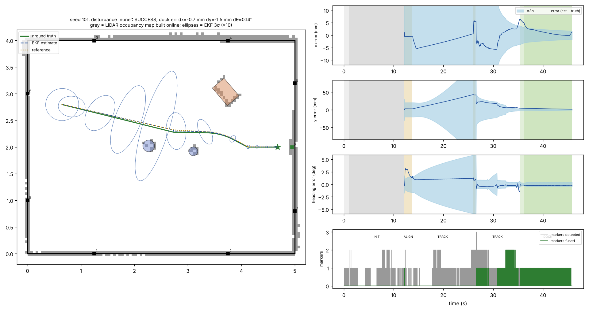

**Reading the figure.**

* **12–26 s, no marker fused.** Markers are *detected* (grey) but none is
  *fused* (green). They are all beyond the 2.5 m normalised range or above 60°
  view angle, so the envelope rejects them. The robot dead-reckons for 14 s, and
  the ±3σ band in y grows to about 6 cm while the real error reaches 4 cm.
* **About 27 s, re-acquisition.** Markers 7, 8 and the dock marker come within
  range, and the error and band collapse together.
* **Docking.** Close-range dock measurements pin the estimate to about 1 mm.

The trial shows the cost of the conservative envelope: long blind segments in
the middle of the room. It also shows the filter honestly reporting that cost.
A larger dock marker, or landmarks on the obstacles, would shorten the blind
segment.

**Consistency versus responsiveness.** Q was scaled by α and R by β under the
push disturbance (8 seeds each, same seeds):

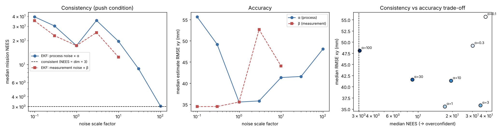

| α (Q scale) | Median NEES | Median RMSE (mm) | Success | Measurements gated |
|---|---|---|---|---|
| 0.1 | 39 | 56 | 6/8 | 78 |
| 0.3 | 30 | 49 | 8/8 | 33 |
| **1 (used)** | **17** | **36** | **8/8** | **23** |
| 3 | 36 | 36 | 7/8 | 16 |
| 10 | 20 | 41 | 7/8 | 11 |
| 30 | 8.9 | 42 | 7/8 | 9 |
| 100 | 3.1 | 48 | 7/8 | 1 |

**Interpretation.**

* **Small Q makes the filter trust odometry.** After a push (which odometry
  cannot see, because the wheels slip) the innovation is huge and markers are
  gated. That causes slow recovery and re-localisations: two of eight
  α = 0.1 runs timed out.
* **Large Q restores consistency but loses accuracy.** NEES reaches the ideal 3
  at α = 100, but the filter then follows every noisy range measurement and
  RMSE rises 33 %.
* **We keep α = 1, the RMSE minimum.** Its overconfidence is concentrated in
  the seconds after a disturbance, which the gate and watchdog handle.
* **Sample size.** With 8 seeds the curve is not monotone (α = 3 is noisy).
  The trend from the end points is clear; the ranking of neighbouring values
  is not.

**What if R were ten times smaller (β = 0.1)?** Median NEES rises from 17 to
35 and RMSE does not improve (34.5 mm against 35.6 mm). The filter believes
each marker almost exactly, so correlated range errors pass straight into the
pose, and more innovations exceed the gate after disturbances. Success was
unchanged at 8/8 in this sample. Raising R tenfold (β = 10) gives
NEES 12 and RMSE 44 mm: the filter becomes sluggish.

## 6. Part D: control

Code: [`tb3dock/controller.py`](tb3dock/controller.py) · Planner: [`tb3dock/planner.py`](tb3dock/planner.py)

**Controller.** A discrete LQR runs on the tracking-error model at the current
reference speed, giving u = u_ref − K(v_r, ω_r)·e on the **estimated** state.

**Weights (Bryson's rule).** These come from the largest acceptable
excursions:

* e_x, e_y ≤ 5 cm
* e_θ ≤ 0.15 rad
* δv ≤ 0.10 m/s
* δω ≤ 1.0 rad/s

So Q = diag(400, 400, 44.4) and R = diag(100, 1).

**Resulting gain** at v_r = 0.18 m/s:

```
K = [[1.90, 0,     0   ],
     [0,    16.7,  6.09]]
```

The closed-loop poles are −2.0, −6.6 and −0.54 s⁻¹. The lateral pole scales
with v_r, which is the controllability result again.

**Limits.**

* **Speed limits.** Wheel-rate saturation (6.5 rad/s) is applied with the
  curvature preserved. The body limits are v ≤ 0.22 m/s and ω ≤ 2.84 rad/s,
  from the TB3 specification.
* **Reference.** The reference is time-parameterised to v ≤ 0.18 m/s, lateral
  acceleration ≤ 0.25 m/s², ω ≤ 1.2 rad/s and |a| ≤ 0.25 m/s².
* **Falling behind.** If the robot falls more than 10 cm behind (for example
  after a push), the reference waits for it.
* **Docking.** The final approach runs at 6 cm/s.

**Tracking error versus control effort.** R was scaled from 0.1× to 10×
(8 seeds each, nominal):

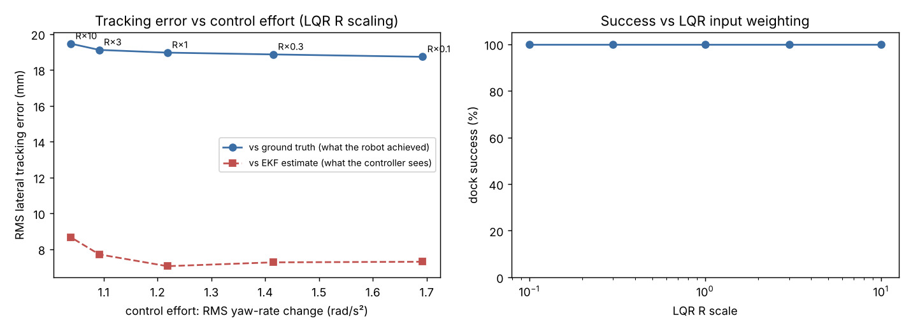

| R scale | Lateral error vs estimate (mm) | Lateral error vs truth (mm) | RMS dω/dt (rad/s²) |
|---|---|---|---|
| 0.1 | 7.3 | 18.7 | 1.69 |
| 1 (used) | 7.1 | 19.0 | 1.22 |
| 10 | 8.7 | 19.5 | 1.04 |

**Interpretation.**

* **R trades effort against error as expected.** Effort falls 38 % from R×0.1
  to R×10, and the error the controller can *see* (against the estimate) rises
  from about 7 to 9 mm.
* **Estimation limits the tracking accuracy, not the controller.** Error
  against *truth* hardly moves (18.7 to 19.5 mm), because it is dominated by
  the estimation error (median 16 mm). Tighter gains cannot remove error the
  controller cannot observe.
* **Why the default R is kept.** It sits at the knee of the curve: effort is
  28 % lower than R×0.1 at the same tracking error.

**Control package.** The controller, reference generation and docking logic
live in [`tb3control/`](tb3control) with their own tests, design report and
evaluation: a Kanayama baseline, an LQI extension, and a docking guard. See
[`tb3control/README.md`](tb3control/README.md).

## 7. Part E: integration and robustness

Every condition uses the same seeds (random obstacle layout and start pose),
so comparisons between conditions are paired.

**Success criterion.** The criterion is measured with ground truth:

* final |dx| < 30 mm, |dy| < 20 mm and |dθ| < 3°;
* no collision;
* mission completed within 180 s.

| Condition | n | Success (95 % CI) | Median \|dy\| (mm) | p95 \|dy\| (mm) | Median estimate RMSE (mm) | Median mean NEES | Mean re-localisations |
|---|---|---|---|---|---|---|---|
| Nominal | 30 | **30/30** (89–100 %) | 1.0 | 3.4 | 16 | 5.5 | 0 |
| Push (2 × 4 N for 0.25 s, random direction) | 12 | 12/12 (76–100 %) | 1.0 | 4.5 | 34 | 17 | 0.75 |
| Camera blackout 10 s mid-mission | 12 | 12/12 | 1.3 | 2.8 | 21 | 5.2 | 0 |
| 3× LiDAR / camera / gyro noise | 12 | 12/12 | 0.7 | 2.0 | 13 | 6.2 | 0 |
| Motor gain mismatch (0.90 / 1.08) | 12 | 12/12 | 3.3 | 4.5 | 11 | 4.6 | 0 |
| Low tyre friction (μ = 0.4) | 12 | 12/12 | 1.1 | 1.8 | 12 | 6.2 | 0 |
| Combined (pushes, 6 s blackout, 2× noise, motor mismatch, μ = 0.6, gyro bias) | 12 | 11/12 (65–99 %) | 2.0 | 3.7 | 63 | 62 | 0.92 |

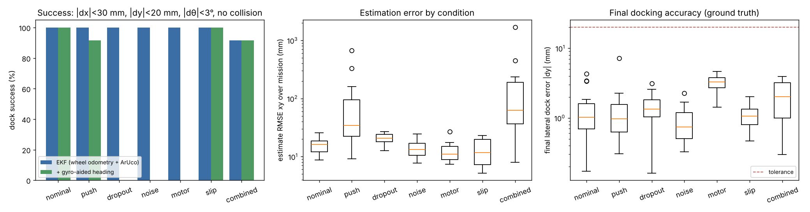

**Why the system behaves this way.**

* **Camera blackout.** σ grows during the gap, as it should, and the estimate
  stays inside its 3σ band. At 16 cm/s the error accumulated over 10 s
  (about 2 cm) is well inside the gate, so the first marker after the gap is
  accepted.
* **Motor gain mismatch.** The robot's achieved speed differs from the command
  by ±10 %. The LQR feedback on the estimate absorbs this, but leaves the
  largest residual lateral docking error (3.3 mm). That is a steady-state error
  from proportional-only feedback with a mismatched plant gain.
* **Low friction.** The wheels slip only under acceleration, and the
  acceleration limits in the reference keep that small.
* **Pushes.** These are the hardest single disturbance. The wheels slip, so the
  encoders do not see the motion and the true pose jumps outside the
  covariance. Markers are then gated until the watchdog re-localises. This
  happened in 0.75 runs per trial on average, at a cost of about 8 s.
* **Noisy LiDAR.** This causes many more replans (13 per run against 0.8),
  because noisy returns occasionally block the path. The planner handles it,
  but it is the main source of wasted motion.

### 7.1 Value of each component (ablation)

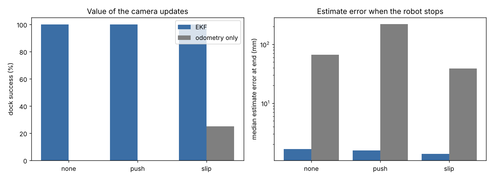

| Variant | n | Success | Median \|dy\| (mm) | Median estimate RMSE (mm) | Comment |
|---|---|---|---|---|---|
| Full EKF (nominal) | 30 | 30/30 | 1.0 | 16 | |
| Odometry only after start-up | 12 | **0/12** | 63 | 44 | Calibrated odometry still drifts about 6 cm over the 6 m mission |
| Odometry only + pushes | 12 | 0/12 | 217 | 110 | 1 collision |
| Odometry only + low friction | 12 | 3/12 | 35 | 27 | |
| Uncalibrated (datasheet geometry, no range-bias correction) | 12 | **1/12** | 31 | 185 | 6 timeouts. The biased model makes the filter reject good markers and re-localise about 10 times per run |
| **Gyro-aided heading** (extension) | 12 | 12/12 | **0.6** | **12** | Heading RMSE 0.52° against 0.85° |
| Gyro + push | 12 | 11/12 | 1.4 | 23 | |
| Gyro + low friction | 12 | 12/12 | 0.9 | 15 | |
| Gyro + combined | 12 | 11/12 | 1.2 | 34 | |

**Gyro, compared honestly.** The gyro improves nominal accuracy by about 25 %,
and it halves the estimate error in the combined condition. It did **not**
improve success under pushes. A push also *translates* the robot, which
neither wheels nor gyro can see. In addition, our gyro noise model
(white noise at 0.005 rad/s) proved overconfident: NEES 25 against 17 under
pushes, because sampling the rate at 20 Hz on a rocking chassis adds aliasing
error that the model omits. Seed 105 failed in both gyro conditions, with the
estimate 4.5 cm off at the dock and 108 markers gated. That is a consistency
failure, not an accuracy failure.

## 8. Failures, diagnosis and limits of the approach

The full development history is in
[`docs/development_log.md`](docs/development_log.md): a caster-friction bug, a
logging time skew, the range-bias model, initialisation divergence and the
odometry noise statistic. This section covers failures remaining in the final
evaluation.

### 8.1 Combined-disturbance failure, seed 106: diagnosed and fixed (v2)

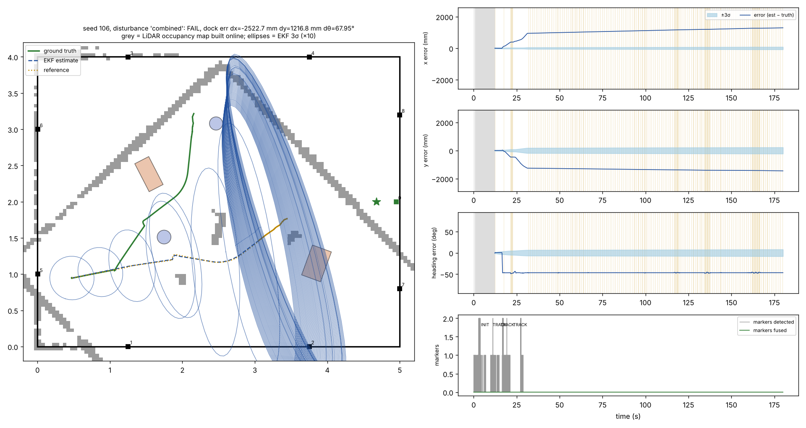

**Trace.**

1. At t ≈ 17 s a push with friction μ = 0.6 spun the robot 45° while the
   wheels slipped. Odometry did not see it, and the EKF heading σ was about 2°.
2. The LiDAR map was then built on a pose rotated 45°. The skewed walls are
   visible in the figure.
3. Every replanned path immediately looked blocked. The robot replanned every
   scan (a *livelock*) while facing a wall where no marker was in view.
4. The divergence watchdog needs in-envelope markers, so it never fired. The
   mission timed out at 180 s.

**Fix (v2, `livelock_relocalise=True`).** If eight or more replans happen
within 10 s, the LiDAR map disagrees with the pose. The robot then discards the
map and re-localises. The same seed with the fix succeeds: one re-localisation,
docked with dy = 0.1 mm.

**Verification on the same seeds:** in [§8.2](#82-v2-verification), the combined condition goes from 11/12 to 12/12.

The fix is off by default so that every other table stays reproducible from
exactly the code that produced it.

### 8.2 v2 verification

| Condition | v1 success | v2 success | Mean replans per run, v1 → v2 | Mean re-localisations, v1 → v2 |
|---|---|---|---|---|
| Push | 12/12 | 12/12 (identical runs: the trigger never fired) | 1.1 → 1.1 | 0.75 → 0.75 |
| Combined | 11/12 | **12/12** | 59.8 → 2.3 | 0.92 → 1.0 |

The fix only changes behaviour in the run that was livelocked, and leaves
every other run bit-for-bit identical. 24 trials is too few to claim a success
rate. What it shows is that this specific failure mechanism is removed and
nothing else regresses.

### 8.3 Limits of the approach

* **Kidnapping is detected, not modelled.** Unmodelled slip (pushes) is
  handled by detect-and-re-localise. A better fix would be slip detection that
  compares wheel odometry with gyro and LiDAR scan matching, or a
  multi-hypothesis filter.
* **Overconfidence.** NEES is about 5 in nominal conditions against an ideal
  of 3. The remaining correlated errors (range bias that varies with view
  angle, chassis pitch) would need state augmentation, such as estimating the
  range bias online, rather than more noise.
* **Simulation optimism.** The ArUco measurements here are cleaner than real
  ones: no motion blur, no lens distortion, perfect lighting and no latency.
  The bearing σ of 0.12° would be several times larger on a real Pi camera.
  The pipeline handles this structurally (measured R, gating), but the
  numbers above should not be read as predictions for a real robot. Camera
  latency, which real systems have and this simulation does not, is not
  modelled.
* **What the results support.** They support robustness to the disturbance
  classes tested, at the magnitudes tested. A 4 N push is the largest that
  never tips the robot; 5 N tips it in some directions. With n = 12 per
  condition, "12/12" means a success rate of at least 76 % with 95 %
  confidence, not 100 %.
* **Scope.** The team chose to complete the project in simulation only;
  real-hardware implementation was not attempted.

## 9. Reproducing every result

```bash
./reproduce.sh            # calibration → analysis → 450+ Monte Carlo trials → report → videos
```

Or step by step:

| Step | Command | Output |
|---|---|---|
| Camera calibration | `python scripts/calibrate_camera.py` | `config/calibration.json`, `results/camera_calibration.*` |
| Actuator identification | `python scripts/identify_actuator.py` | `results/actuator_id.*` |
| Odometry calibration and Q | `python scripts/calibrate_odometry.py` | `results/odometry_calibration.*` |
| Marker bias and R | `python scripts/characterise_markers.py` | `results/marker_characterisation.*` |
| Part A analysis | `python scripts/analyse_model.py` | `results/model_analysis.*` |
| Monte Carlo | `python scripts/evaluate.py --exp all --n 12` | `results/eval/*.csv` |
| Tables and figures | `python scripts/make_report.py` | `results/summary.md`, `results/*.png` |
| Single-trial plots | `python scripts/plot_trial.py --seed 106 --dist combined` | `results/trial_*.png` |
| Demo clips | `python scripts/make_video.py` | `results/videos/*.mp4` |

Seeds are fixed, so results are deterministic on the same platform. Different
CPUs and MuJoCo versions can change individual trials slightly through
floating-point differences.

## 10. Repository layout

```
tb3dock/            the pipeline (no ground truth used outside sim.py/evaluation.py)
  config.py         platform, sensor and world parameters; calibration I/O
  scene.py          MJCF builder: room, TB3, obstacles, markers
  sim.py            SimRobot (sensors/actuators) + GroundTruthProbe (evaluation only)
  rig.py            calibration test-rig helpers (offline only)
  model.py          kinematics, error model, controllability/observability
  odometry.py       encoder odometry
  vision.py         ArUco detection, PnP, range/bearing in {B}
  ekf.py            EKF (+ gyro-aided prediction)
  localisation.py   batch spin localisation
  mapping.py        LiDAR log-odds occupancy grid
  planner.py        A*, shortcutting, corner rounding
  controller.py     imports the control package (tb3control)
  mission.py        state machine
  evaluation.py     trial runner, logger, metrics
tb3control/         Part D control package: LQR, LQI, Kanayama baseline, reference,
                    tracker, saturation, analysis, test plant (see tb3control/README.md)
control_scripts/    control design report, step response, LQI tuning, control evaluation
tests/              unit tests for the control package (python -m pytest -q tests)
scripts/            calibration, analysis, evaluation, report, video, live viewer
config/             calibration.json
results/            figures, tables (summary.md), per-trial CSVs, videos; results/control/ for Part D
docs/               development log (what failed, how it was diagnosed, what changed)
```

## 11. Contribution statement

> **Team: complete the rows for each member before submission.** Each member
> must be able to explain the whole pipeline at the viva.

| Member | Student ID | Contribution |
|---|---|---|
| Phoenix Radus | 25485451 | Control (Part D): `tb3control/` package (gain-scheduled LQR tracker, reference generation, saturation, docking), controller analysis and evaluation (`control_scripts/`, `tests/`), Kanayama comparison, LQI extension, docking guard |
| Rijul Banerjee | 24964177 | Estimation (Part C): responsible for the estimation section. Set up the pipeline from a fresh install and reproduced the EKF results against §5 (nominal seeds 101–104: all docked, estimate RMSE 10.5–18.2 mm, mean NEES 4.1–13.5); reviewed the estimator design (`tb3dock/ekf.py`, `tb3dock/localisation.py`, `tb3sensing/measurement.py`); added `requirements.txt` |
| | | |

## 12. Generative AI declaration
| Tool | Used for | Team verification / changes |
|---|---|---|
| Claude (Anthropic) | Generating the simulation, sensing, estimation and control code; calibration, evaluation and analysis scripts; figures; and first drafts of this project page and the development log. Also used for debugging errors, help with GitHub, and explaining how the code and methods work. | **Rijul:** set up the pipeline from a fresh install and identified and added the missing dependencies (`requirements.txt`); re-ran the nominal mission on seeds 101–104 and confirmed the estimation results match §5; reviewed the estimator code (`tb3dock/ekf.py`, `tb3dock/localisation.py`, `tb3sensing/measurement.py`) so it can be explained. |
