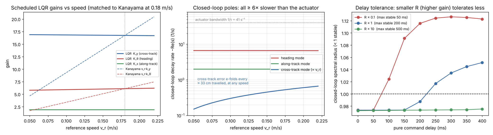
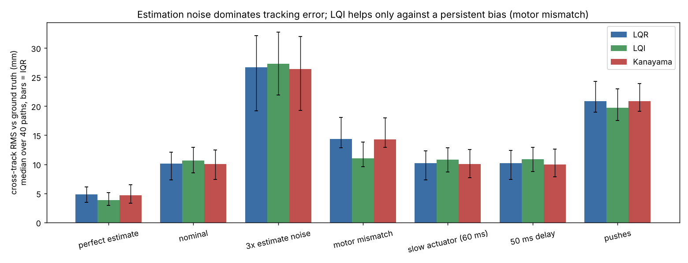
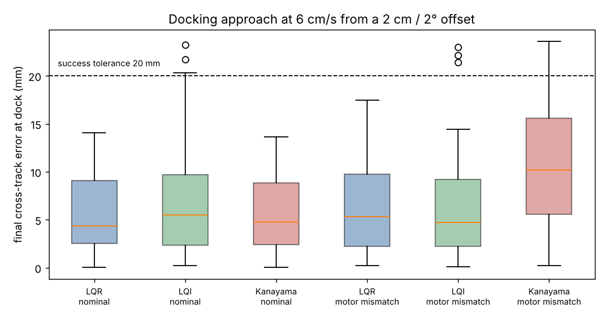
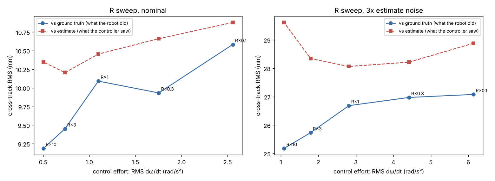

# Part D — Control: trajectory tracking for the TurtleBot3 (Track A)

`tb3control` is the control half of the pipeline. It takes the EKF's pose
**estimate** and a path from the planner, and produces wheel-rate commands.

* **Design:** a gain-scheduled discrete LQR on the linearised tracking-error
  model, with weights from Bryson's rule.
* **Evaluation:** in the full MuJoCo pipeline (30/30 nominal docks, about 1 mm
  median lateral dock error) and on a fast standalone plant. The plant runs
  hundreds of paired trials, compares against a published baseline (Kanayama
  et al. 1990) and tests one extension (LQI).
* **Self-contained:** needs only numpy and scipy, and never touches ground
  truth.

```
python -m pytest -q tests                       # 37 unit tests (~2 s)
python control_scripts/design_report.py         # gains, poles, delay/actuator margins
python control_scripts/step_response.py         # recovery from offsets + example path
python control_scripts/tune_lqi.py              # choosing the LQI integral weight
python control_scripts/evaluate_control.py      # 40 paths x 7 conditions x 3 controllers (~4 min)
python control_scripts/pipeline_lqi_report.py   # LQR vs LQI in the full pipeline (after scripts/evaluate.py --exp control_lqi)
```

## 1. Interface

```python
from tb3control import LQRController, TrajectoryTracker, Trajectory, round_corners
tracker = TrajectoryTracker(LQRController(), geom)   # geom: calibrated r_l, r_r, b (config/calibration.json)
tracker.start(Trajectory(round_corners(waypoints)))  # path from the planner
step = tracker.update(pose_estimate)                  # every 50 ms; pose = [x, y, theta] from the EKF
send(step.wheels)                                     # wheel-rate commands, rad/s
```

The full mission (`tb3dock/mission.py`) uses the same objects:
`TrajectoryTracker.track_step` for `TRACK` and `DOCK`, `heading_control` for
`ALIGN` and `FACE_DOCK`, and `saturate` for every command. Refactoring the
mission onto this package reproduced the published trials exactly (seeds 101,
107, and 106 under combined disturbances), so the team's results stand
unchanged.

## 2. Design

### 2.1 Model the controller is designed on (`models.py`)

The controller's state is the tracking error of the **actual** pose relative to
the **reference**, expressed in the reference frame:

```
e = [ R(θ_r)ᵀ (p − p_r) ;  θ − θ_r ] = [along-track, cross-track, heading]
```

Exact dynamics, then the linearisation about e = 0 with δu = u − u_r:

```
ė_x = v cos e_θ − v_r + ω_r e_y        ė = A(v_r, ω_r) e + B δu
ė_y = v sin e_θ − ω_r e_x              A = [[0, ω_r, 0], [−ω_r, 0, v_r], [0, 0, 0]]
ė_θ = ω − ω_r                          B = [[1, 0], [0, 0], [0, 1]]
```

A unit test checks this Jacobian numerically against the nonlinear equations.

**Controllability:**

| Operating point | rank of 𝒞 |
|---|---|
| Moving (v_r = 0.15 m/s) | 3 |
| Turning in place (ω_r = 0.8 rad/s) | 3 |
| At rest | **2** |

At rest, cross-track error can't be corrected by linear feedback (Brockett's
condition). Hence:

1. Gains are designed at |v_r| ≥ 5 cm/s (`V_FLOOR`).
2. In-place turns use a separate heading controller.
3. LQI does not integrate below that speed.

**Discretisation:** exact zero-order hold at 50 ms (`c2d`, matrix
exponential). The controller really does hold each command for 50 ms, so the
design model is the loop that runs, with no Euler approximation.

### 2.2 Weights and gains (`lqr.py`)

Bryson's rule is Q = 1/e_max² and R = 1/u_max², using the largest acceptable
error and correction:

| | along-track | cross-track | heading | Δv | Δω |
|---|---|---|---|---|---|
| Max acceptable | 5 cm | 5 cm | 0.15 rad | 0.10 m/s | 1.0 rad/s |
| Weight | 400 | 400 | 44.4 | 100 | 1 |

The DARE gives u = u_ref − K e. At 0.18 m/s:

```
K = [[1.90, 0,     0   ],     Δv = −1.90 e_x                    (speed fixes along-track error)
     [0,    16.7,  6.09]]     Δω = −16.7 e_y − 6.09 e_θ         (turn rate fixes cross-track and heading)
```

| v_r (m/s) | K_y | K_θ | Closed-loop poles (s⁻¹) |
|---|---|---|---|
| 0.06 | 16.9 | 5.80 | −6.63, −2.00, −0.18 |
| 0.18 | 16.7 | 6.09 | −6.61, −2.00, −0.54 |
| 0.22 | 16.7 | 6.18 | −6.60, −2.00, −0.66 |

**How to read the poles:**

* **Heading mode (−6.6 s⁻¹) and along-track mode (−2.0 s⁻¹)** don't depend on
  speed.
* **Cross-track mode** scales with v_r, because cross-track error only changes
  by driving at an angle (ė_y = v_r e_θ). Dividing gives a distance constant:
  cross-track error e-folds every ≈ 33 cm of travel, at any speed.
* **Gains barely change on straight lines.** Scheduling matters through ω_r on
  curves and through the speed floor. The gain is cached per 1 mm/s ×
  0.01 rad/s bin.



### 2.3 What limits the gains (`analysis.py`)

1. **Actuator bandwidth.** The identified wheel lag is τ = 24.6 ms (1/τ = 41 s⁻¹).
   The fastest closed-loop pole (−6.6 s⁻¹) is more than 6× slower. Closing the
   loop on the actuator-augmented 5-state plant with the same gain leaves the
   spectral radius unchanged (0.9733 → 0.9734 even at τ = 60 ms).
2. **Delay.** The design stays stable with up to 200 ms of pure command delay.
   Higher gains tolerate less: R × 0.1 → 50 ms; R × 10 → 500 ms (right panel
   above).
3. **Wheel saturation.** At v_r = 0.18 m/s the wheels already turn at
   5.5 rad/s of a 6.5 rad/s limit. Corrections above about 0.4 rad/s saturate.
   Saturation scales both wheels together so curvature is kept (`limits.py`),
   and the robot slows on the commanded arc instead of being pushed onto a
   different one. About 10 % of control steps saturate even with a perfect
   estimate, mostly in corners.
4. **Estimate noise.** Feedback acts on the estimate, so higher gains turn
   estimate noise into commands without reducing true error (§3.2).

Gain margin, a common multiplier on both inputs: stable from about 0 up to
6.4×.

### 2.4 Reference and the "waiting" clock (`reference.py`, `tracker.py`)

**Speed profile.** The path becomes a minimum-time speed profile under five
limits, applied in a forward and a backward pass:

| Limit | Value |
|---|---|
| Speed | v ≤ 0.18 m/s |
| Lateral acceleration | ≤ 0.25 m/s² |
| Yaw rate | ≤ 1.2 rad/s |
| Longitudinal acceleration | ≤ 0.25 m/s² |

The feedforward is (v_r, ω_r = v_r·κ). The 0.18 m/s cap leaves headroom below
the 0.22 m/s robot limit for feedback.

**Waiting clock.** The reference clock stops while the robot is more than
10 cm behind (`WAIT`). After a push or stall, the reference therefore doesn't
run away and drive the linear controller far outside its design region.

### 2.5 Modes

| Mode | Law |
|---|---|
| `ALIGN`, `FACE_DOCK` | `heading_control`: ω = sat(2·e_θ, 1.2 rad/s), turning in place |
| `TRACK` | LQR on the planner's path |
| `DOCK` | LQR on a 0.55 m straight approach at 6 cm/s (`straight_approach`) |

## 3. Results

### 3.1 Full pipeline (MuJoCo, EKF in the loop)

These are the team's published numbers, all with this controller:

* **Nominal:** 30/30 docks; median lateral dock error 1.0 mm (p95 3.4 mm);
  p95 heading error 0.63°.
* **Six disturbance conditions:** 71/72.
* **LQR R sweep (0.1× to 10×):** control effort −38 %. Lateral error against
  *truth* moved only 18.7 → 19.5 mm, while error against the *estimate* moved
  7 → 9 mm. Tracking is estimation-limited.

### 3.2 Standalone plant: controllers × conditions

This uses 40 paired random paths. The plant has the team's true-versus-calibrated
wheel geometry, the identified actuator lag, and an estimate error sized to the
full pipeline's EKF. Values are cross-track RMS against truth (median over
paths, mm); full tables are in `results/control/summary.md`.

| Condition | LQR | LQI | Kanayama |
|---|---|---|---|
| Perfect estimate | 4.8 | **3.8** | 4.7 |
| Nominal | 10.1 | 10.6 | 10.0 |
| 3× estimate noise | 26.7 | 27.3 | 26.3 |
| Motor mismatch (0.90 / 1.08) | 14.3 | **11.0** | 14.3 |
| Slow actuator (60 ms) | 10.2 | 10.8 | 10.0 |
| 50 ms delay | 10.2 | 10.9 | 10.0 |
| Pushes | 20.8 | **19.8** | 20.8 |



**What the results support:**

* **Estimation noise dominates.** A perfect estimate halves the error
  (10.1 → 4.8 mm). No controller choice recovers that.
* **LQR and Kanayama tie on path tracking.** Their gains were matched at
  0.18 m/s, so the nonlinear law adds nothing at these error sizes.
* **They differ at the dock.** Kanayama's lateral gains scale with v_r and
  collapse at 6 cm/s, while the LQR's do not. Median final cross-track error at
  the dock under motor mismatch: Kanayama 10.2 mm, LQR 5.3 mm.
* **LQI removes a persistent bias.** Under motor mismatch, plain LQR settles at
  e_y = d/K_y ≈ 12 mm on a straight line. LQI drives this to 0, and is better
  on 38 of 40 paths with a median of −3.8 mm. With noise it is slightly worse
  (+0.9 mm nominal, +30 % effort), because augmenting the model raises K_y from
  16.7 to 23.8, which passes more estimate noise. It is also worse at the dock
  (p95 20.4 against 11.6 mm nominal).
* **Decision:** LQR stays the default. LQI is offered as an option
  (`MissionParams(controller="LQI")`) for robots with a known motor imbalance.



### 3.3 LQI in the full pipeline (paired seeds)

Seeds 100–111, the same as the team's nominal and disturbance trials:

| Condition | Controller | Success | Median dock \|dy\| | p95 dock \|dy\| | Track RMS lateral vs truth |
|---|---|---|---|---|---|
| Nominal | LQR | 12/12 | 1.2 mm | 1.6 mm | 16.7 mm |
| Nominal | LQI | 12/12 | 1.0 mm | 1.7 mm | 16.2 mm |
| Motor mismatch | LQR | 12/12 | 3.3 mm | 4.5 mm | 7.7 mm |
| Motor mismatch | LQI | 12/12 | **1.3 mm** | **2.0 mm** | 9.3 mm |
| Pushes | LQR | 12/12 | 1.0 mm | 4.5 mm | 24.8 mm |
| Pushes | LQI | 11/12 | 1.2 mm | 149 mm | 23.6 mm |

**Motor mismatch.** LQI removes the steady-state dock error that the team's
results attributed to proportional-only feedback (3.3 → 1.3 mm). Tracking RMS
along the way is slightly worse.

**The one push failure was not the control law.** A second push rotated the
robot 23° without odometry noticing, 2 s before docking. `FACE_DOCK` then
aligned to the wrong heading, the dock marker never came into view, and the
approach was driven blind. With LQR the push landed at a different moment.

### 3.3a Docking guard (fix for that failure)

`MissionParams(dock_guard=True)` only approaches while the dock marker is
actually detected. If it is unseen for 1.5 s while facing or approaching the
dock, the robot stops and re-localises. Verified on 48 paired trials:

| Condition | Without guard | With guard |
|---|---|---|
| LQR, nominal | 12/12 | 12/12 (identical runs, no false triggers) |
| LQR, pushes | 12/12 | 12/12 (identical runs) |
| LQR, combined | 11/12 | 11/12 (seed 106 is the separate replan livelock, fixed by the team's v2 change) |
| LQI, pushes | 11/12 | **12/12** (about 4.5 s slower, median) |

The guard is off by default so every published table reproduces exactly.

### 3.4 R sweep on the standalone plant

| R scale | Error vs truth (mm) | Effort (rad/s²) | Saturated |
|---|---|---|---|
| 0.1 | 10.6 | 2.56 | 23 % |
| 1 (used) | 10.1 | 1.10 | 11 % |
| 3 | 9.5 | 0.74 | 10 % |
| 10 | 9.2 | 0.50 | 9 % |

Lower gain (larger R) is slightly *more* accurate here and much gentler,
because it filters estimate noise. The full pipeline showed a flat trend
(18.7–19.5 mm), so the evidence says R could be raised about 3× at no cost,
with more delay margin. We kept the Bryson value because every full-pipeline
result was produced with it. This is the first thing to change.



## 4. Limits

* **Linear design, nonlinear plant.** Recovery from a 40 cm / 0.6 rad offset
  still works (it settles in 8.3 s with a 56° heading peak), but this is
  outside the region the LQR guarantees anything about. The waiting reference
  and the replanner keep the robot near the path in practice.
* **The standalone plant's estimate model is simplified.** Gauss-Markov error,
  not a real EKF. Its absolute numbers are lower than the pipeline's; use it
  for *comparisons* between controllers, not for absolute accuracy claims.
* **Pushes in the standalone plant are visible to the estimate immediately.**
  This isolates controller recovery. In the full pipeline, odometry misses
  them; that is an estimation problem handled by re-localisation.

## 5. Files

| File | Contents |
|---|---|
| `models.py` | kinematics, error model + exact dynamics, ZOH, controllability, integral / actuator augmentations |
| `lqr.py` | Bryson weights, DARE, gain schedule with speed floor |
| `controllers.py` | `LQRController`, `LQIController`, `KanayamaController`, `heading_control` |
| `reference.py` | speed-profile generation, corner rounding, straight docking approach |
| `limits.py` | curvature-preserving saturation |
| `tracker.py` | reference clock (waits when behind), align → track, saturation bookkeeping |
| `analysis.py` | poles, actuator-lag and delay robustness, gain margin |
| `plant.py` | standalone test plant (true geometry, lag, mismatch, delay, noisy estimate, pushes) |
| `../tests/test_control.py` | 37 unit tests |
| `../control_scripts/` | design report, step response, LQI tuning, evaluation, pipeline comparison |
