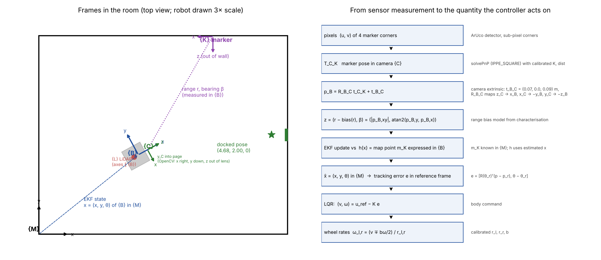
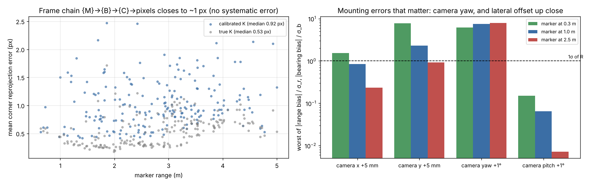
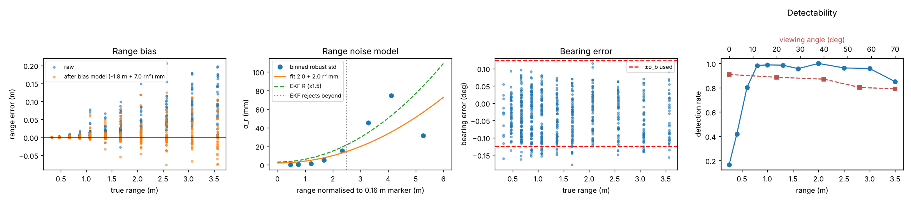
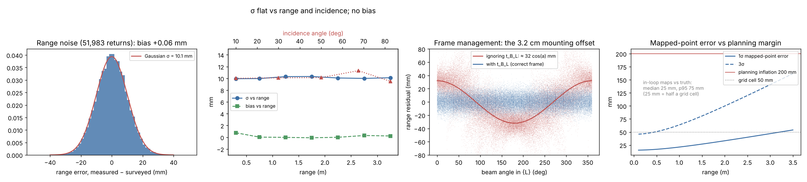

# Part B — Sensing: calibration, noise handling and frame management (Track A)

`tb3sensing` is everything between the raw sensors and the estimator. The
TurtleBot3 has four:

| Sensor | Rate | Used for |
|---|---|---|
| Wheel encoders | 4096 ticks/rev, 20 Hz | odometry, the EKF prediction |
| Forward camera | 640×480, 10 Hz | ArUco range and bearing, the EKF update |
| 2D LiDAR (LDS-01) | 360 beams, 5 Hz | occupancy map and obstacle stop |
| Gyro | — | optional heading prediction |

The package does three jobs:
1. **Calibrates** each sensor from data.
2. **Models** each sensor's noise and bias, so the estimator is told the truth
   about it.
3. **Manages the frames** that connect a pixel or a LiDAR beam to the map.

```
python -m pytest -q tests                     # 52 tests (15 sensing), ~2 s
python scripts/calibrate_camera.py            # K, distortion            -> config/calibration.json
python scripts/calibrate_odometry.py          # r_l, r_r, b, odometry noise k
python scripts/characterise_markers.py        # range bias, R, envelope
python scripts/sensing_lidar.py               # LiDAR noise/bias/dropout, frame offset, map accuracy (~2.5 min)
python scripts/sensing_frames.py              # frame-chain check, extrinsic sensitivity
```

| Module | Contents |
|---|---|
| `frames.py` | frame definitions {M} {B} {C} {L} {K}, camera/LiDAR extrinsics, transforms |
| `vision.py` | ArUco detection (sub-pixel corners), PnP (IPPE square), range and bearing in {B} |
| `measurement.py` | marker measurement model: envelope, range-bias correction, R. Used by every EKF update |
| `odometry.py` | ticks → wheel arcs → (Δs, Δθ) with calibrated geometry; midpoint integration |
| `lidar.py` | beam validity, beam → {B} → {M} transforms, mapped-point error budget |

The pipeline (`tb3dock/`) imports these modules. Moving them here reproduced
the team's published trials exactly (seed 101 nominal; seed 106 combined).

## 1. Frames



| Frame | Definition |
|---|---|
| {M} map | Room corner origin, x along the 5 m wall, z up |
| {B} base | Axle midpoint on the floor, x forward, y left. The EKF state is the pose of {B} in {M} |
| {C} camera optical | OpenCV convention: z out of the lens, x right, y down. Mounted at t_B_C = (0.070, 0, 0.090) m. R_B_C maps z_C → x_B, x_C → −y_B, y_C → −z_B |
| {L} LiDAR | Axes parallel to {B}, origin t_B_L = (−0.032, 0, 0.140) m |
| {K} marker | Black-square centre, z out of the wall, as `solvePnP` returns it |

**Measurement chain:**

```
pixels --solvePnP(K, dist)--> T_C_K --R_B_C, t_B_C--> p_B --> (r, β) --bias, R--> EKF
LiDAR beam (r_i, a_i) --+t_B_L--> p_B --R(θ̂), (x̂, ŷ)--> {M} --> occupancy grid
```

### 1.1 End-to-end frame check (`scripts/sensing_frames.py`)

The four corners of each visible marker are projected from the surveyed map,
through {B} and {C}, to pixels. They are compared with the corners the
detector finds, at 150 surveyed poses (199 markers).

* **Calibrated K:** median 0.92 px, p95 1.8 px, max 2.5 px.
* **True K:** median 0.53 px.
* **Interpretation:** no systematic offset anywhere, so every sign, axis and
  extrinsic in the chain is right. A swapped axis or a 1 cm extrinsic error
  would show as tens of pixels. The ~0.4 px difference between the two is
  the intrinsic calibration error.

### 1.2 Which mounting error matters

If the software's camera extrinsic were wrong, the measurement would be
biased. Expressed in units of the noise the EKF assumes:

| Mounting error | At 0.3 m (docking) | At 1.0 m | At 2.5 m |
|---|---|---|---|
| Camera yaw +1° | bearing 6.2σ | 7.5σ | 7.9σ |
| Camera lateral +5 mm | bearing **7.7σ** | 2.3σ | 0.9σ |
| Camera forward +5 mm | range 1.5σ | 0.8σ | 0.2σ |
| Camera pitch +1° | 0.15σ | 0.06σ | ~0 |

* **Camera yaw** must be known to well under 0.2°, or every bearing is biased
  by several σ and the gate starts rejecting good markers.
* **Lateral offset** matters most at docking range: 5 mm is 7.7σ at 0.3 m.
  This is the same 5 mm the docking tolerance is built on.
* **Pitch** is nearly irrelevant, because range and bearing use the planar
  projection.



### 1.3 LiDAR mounting offset

The LiDAR sits 3.2 cm behind the axle. Treating it as if it were at the axle
leaves a systematic range error of ≈ 32·cos(a) mm (RMS 33 mm). That is three
times the LiDAR noise, and it would shift every wall in the map. With t_B_L
applied, the residual is pure noise (§3).

## 2. Camera and ArUco measurements

### 2.1 Intrinsics (`scripts/calibrate_camera.py`)

| | |
|---|---|
| Data | 9×6 checkerboard (30 mm squares), 40 random views at 0.35–0.9 m and ±35° tilt |
| Reprojection RMS | 0.42 px |
| Error against simulator truth | f +0.48 %, c_x −0.42 px, c_y −0.40 px |
| Distortion model | radial only (k1, k2) |

Tangential terms and k3 were fixed at zero: with 40 views they traded off
against c_x and biased it by 3.4 px.

### 2.2 Range and bearing model (`scripts/characterise_markers.py`, `measurement.py`)

**Data:** 758 surveyed placements of the robot at ranges 0.25–3.5 m, view
angles 0–70°, five markers including the dock; 647 detections, each processed
exactly as in the mission.

| Step | Model | Why |
|---|---|---|
| Normalise range | rn = r · 0.16 / size | PnP error scales with pixels per marker, so one model serves the 160 mm landmarks and the 100 mm dock |
| Bias correction | r − (−1.8 rn + 7.0 rn²) mm × size/0.16 | PnP reads range long, growing ~ rn² (a ~0.3 px inward corner shift). Mean bias 26 → 4 mm |
| Range noise | σ_r = (3.0 + 2.9 rn²) mm × size/0.16 | Binned std after bias removal, ×1.5 inflation for tails |
| Bearing noise | σ_β = 0.12° | Flat with range |
| Envelope | reject rn > 2.5 m or view > 60° | Beyond this errors are heavy-tailed; rejecting beats pretending they're Gaussian |

* **Detection rate:** above 95 % from 0.8 to 3.0 m. It drops below 0.6 m
  (marker leaves the frame) and to 79 % at 70° view.
* **Why 1.5× inflation is safe:** the inflation and envelope were checked in
  the loop. Nominal EKF NEES is 5.5 (ideal 3). β = 0.1 doubles NEES, and β = 10
  makes the filter sluggish.



## 3. LiDAR (`scripts/sensing_lidar.py`)

**Data:** 60 surveyed poses × 3 scans in the empty room, 63,753 beams. True
ranges were computed analytically from the wall geometry, and beams hitting
the dock were excluded.

| Quantity | Result |
|---|---|
| Range noise σ | 10.1 mm, Gaussian |
| Bias | +0.06 mm, flat with range |
| σ vs range / incidence | flat with both (0.3–3.3 m, 10–80°) |
| Dropouts inside range | 1.0 %, NaN, handled by masking |
| Beyond 3.5 m | always no return; treated as free space up to the limit |

**Noise handling:** NaN beams are dropped. The occupancy grid accumulates
log-odds (+0.85 hit, −0.4 free, clamped), so one noisy return doesn't create
an obstacle and repeated free readings clear one. The emergency stop needs
2 or more returns in the 24 cm zone ahead, so a single bad beam can't trigger
it.

**Mapped-point error budget** (`lidar.point_sigma`):

```
σ_pt² ≈ σ_r² + σ_xy² + (r·σ_θ)²
```

with σ_r = 10 mm and the EKF's nominal pose error (σ_xy ≈ 11 mm per axis,
σ_θ = 0.85°):

| Range | 1σ | 3σ |
|---|---|---|
| 0.5 m | 17 mm | — |
| 1.5 m | 27 mm | — |
| 3.5 m | 54 mm | 162 mm |

The heading term dominates beyond about 1 m. The 3σ error at maximum range
(162 mm) sits inside the 200 mm planning inflation, which is why that
inflation was enough.

**Map accuracy in the loop:** occupancy grids from 6 full missions, built on
the EKF estimate, against the true geometry.

| Metric | Result |
|---|---|
| Median distance to true surface | 25 mm (half a 5 cm cell, the quantisation floor) |
| p95 | 75 mm |
| Within 10 cm | 99 % |
| Within 5 cm | 90 % |



## 4. Wheel odometry

### 4.1 Systematic errors (`scripts/calibrate_odometry.py`)

The robot drove UMBmark 1.5 m squares clockwise and counter-clockwise, plus
straight runs. Results are checked on 6 held-out random trajectories.

| Parameters | r_l (mm) | r_r (mm) | b (mm) | Held-out end error |
|---|---|---|---|---|
| Datasheet | 33.00 | 33.00 | 160.0 | 473 mm, 28.8° |
| UMBmark closed form | 33.25 | 32.75 | 151.4 | 334 mm, 17.7° |
| **Least squares (used)** | **33.28** | **32.39** | **163.4** | **72 mm, 2.3°** |
| Hidden truth | 33.60 | 32.70 | 163.5 | |

Least squares re-integrates the logged ticks over every run, so it sees
absolute scale, which UMBmark cannot. Radii about 1 % under truth are the
tyre's effective rolling radius.

### 4.2 Random errors

Per-wheel arc variance is k·|Δs| with k = 6.6 × 10⁻⁶ m, from 189 one-second
windows. A **median-based** estimator is used because errors are heavy-tailed:
chassis pitch during hard acceleration makes the encoders record motion that
didn't happen, and the plain mean was over 100× larger. This is the EKF's Q.

## 5. What would change on real hardware

* **Camera latency:** 50–150 ms on a Pi camera. Timestamp each image and apply
  the update at the matching point in the odometry history.
* **Bearing noise:** several times larger with real optics and motion blur.
  Re-run the characterisation and let R follow.
* **Camera yaw:** calibrate the mounting to under 0.2° (§1.2), for example by
  hand-eye calibration against a marker at a surveyed pose.
* **LiDAR:** real LDS-01 noise depends on surface reflectivity and incidence,
  unlike the flat σ here. The same script measures it.
